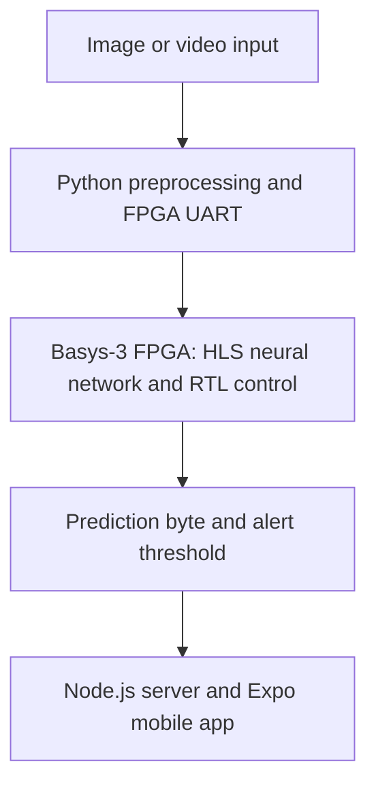
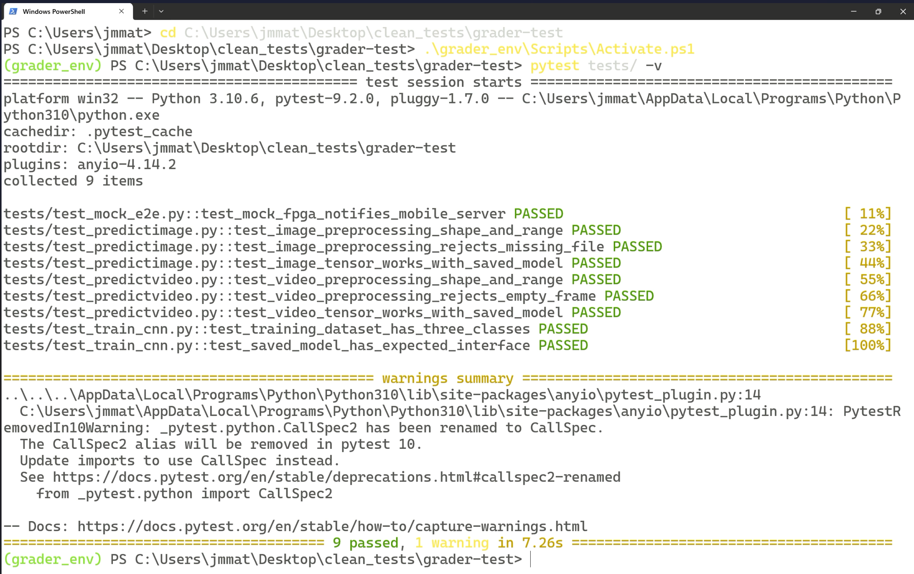
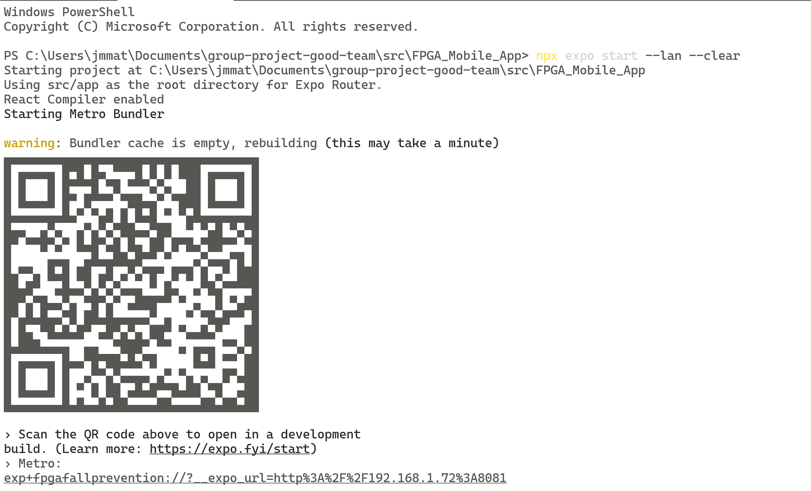
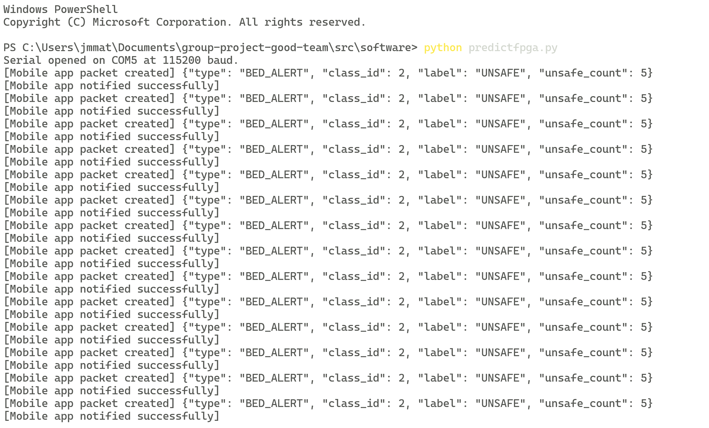

# FPGA-Vision Fall Alert System

## Team

- Devin Roberson (GitHub: @devin-roberson)
- Jan Michael Maturan (GitHub: @jm-mat)
- Joshua Lu (GitHub: @josh8ml)
- Miguel Rodriguez Martinez (GitHub: @MiguelM831)

## Project Description

FPGA-Vision Fall Alert System detects unsafe bed positions or possible falls from image and video input. A lightweight neural-network model classifies frames as `IRRELEVANT`, `SAFE`, or `UNSAFE`, while the FPGA performs inference and sends the result to a mobile application through a network-connected server.

The system is designed to provide a visible alert when multiple consecutive frames are classified as unsafe.

## Prototype Scope

The current prototype includes:

- A TensorFlow/Keras training script.
- A checked-in trained `.h5` model.
- Image-based Keras inference.
- Video-based Keras inference.
- An hls4ml conversion script for generating FPGA-compatible HLS.
- Generated HLS IP for the Basys-3 FPGA.
- Verilog UART, frame-buffer, controller, argmax, and display logic.
- FPGA-to-computer communication over UART.
- A Node.js server that receives fall alerts.
- An Expo mobile application that polls the server and displays a fall warning.
- Hardware-free automated tests and a mock FPGA-to-mobile end-to-end test.
- A physical Basys-3 demonstration recorded in the project video.

The current FPGA model is a simplified resource-conscious model designed for the Basys-3. It uses 32x32 grayscale input and has limited capacity compared with the model planned for the final system.

Before the Project Expo, the team plans to:

- Replace or improve the current FPGA model.
- Add a super-resolution model to improve input-image quality.
- Refine the training dataset and improve classification accuracy.
- Re-run hls4ml conversion after changing the model.
- Re-verify FPGA resource usage, timing, and UART integration.
- Improve robustness of the mobile notification workflow.
- Improve the UX of the mobile notification system.

## System Architecture

The normal hardware path is:
1. predictfpga.py reads a video frame.
2. The frame is converted to grayscale and resized to 32x32 pixels.
3. The frame is transmitted to the FPGA as 1024 raw grayscale bytes over UART.
4. The FPGA frame buffer passes the input to the HLS neural-network IP.
5. The Verilog argmax logic converts the three output scores into a class ID.
6. The FPGA sends the class ID back to the computer over UART.
7. predictfpga.py counts consecutive UNSAFE predictions.
8. When the threshold is reached, the script sends an HTTP alert to the Node.js server.
9. The Expo mobile app polls the server and displays a fall warning.
For grading without hardware, the mock E2E test replaces the FPGA with deterministic UNSAFE prediction bytes.

## Prerequisites
Python 3.x
pip
Node.js and npm
Expo CLI
Expo Go for the mobile demonstration
Vivado 2024.1.2 for optional FPGA simulation and synthesis
Git

Python dependecies are listed in: requirements.txt

The main packages include:
- TensorFlow
- NumPy
- OpenCV
- PySerial
- pytest
- hls4ml

FPGA hardware
The complete hardware demonstration requires:
- Digilent Basys-3 FPGA board
- USB cable
- Computer with Vivado installed
- UART connection to the Basys-3
The grader does not need the Basys-3 board to run the software tests or mock E2E test.

Mobile demonstration
The mobile demonstration requires:
- Android phone
- Expo Go
- Phone and computer connected to the same Wi-Fi network

## Installation
Numbered steps from a clean machine. Document environment variables without their values.
1. Clone the repository:
    git clone https://github.com/SJSU-CMPE-195/group-project-good-team.git
    cd group-project-good-team

3. Create and activate a Python virtual environment.
Windows PowerShell:
    python -m venv grader_env
   .\grader_env\Scripts\Activate.ps1
Linux/macOS:
    python3 -m venv grader_env
    source grader_env/bin/activate

5. Install Python dependencies:
    pip install -r requirements.txt 

6. Install mobile-app dependencies:
    cd src/FPGA_Mobile_App
    npm install
    cd ../..

7. Confirm that the trained model exists:
    src/software/cnn_bed_fall_detection.h5

8. For the mobile demonstration, update the server URL in:
    src/FPGA_Mobile_App/src/app/index.tsx
Set FALL_SERVER_URL to the computer's local Wi-Fi IP address.

9. Update the FPGA serial port and server URL in:
    src/software/predictfpga.py

## Running the Prototype
From the repository root:
    python src/software/train_cnn.py
The training data is stored in:
    src/data/
The trained model is saved to:
src/software/cnn_bed_fall_detection.h5

Run image inference:
    python src/software/predictimage.py

Select an image when the file-selection window opens.

Run Keras video inference:
    python src/software/predictvideo.py

Select a video when prompted. This mode performs inference using the Keras model on the computer.

Start the mobile-app server
From the repository root:
    node src/FPGA_Mobile_App/server/server.js

The server listens on port 3000 by default.

Start the Expo mobile application:
Open a second terminal:
    cd src/FPGA_Mobile_App
    npx expo start --lan

Open the project with Expo Go. The phone and computer must be connected to the same Wi-Fi network.

Before starting the app, update FALL_SERVER_URL in:
    src/FPGA_Mobile_App/src/app/index.tsx

Set it to the computer's local Wi-Fi address:
    const FALL_SERVER_URL = 'http://YOUR_COMPUTER_IP:3000';

Run FPGA inference
1. Program the Basys-3 with the FPGA bitstream.
2. Connect the Basys-3 to the computer.
3. Confirm the FPGA serial port in src/software/predictfpga.py.
4. Confirm APP_SERVER_URL uses the computer's current Wi-Fi IP address.
5. Start the Node.js server.
6. Start the Expo mobile application.
7. Run:
    python src/software/predictfpga.py

The script converts each video frame to a 32x32 grayscale image, sends it to the FPGA over UART, receives the prediction byte, and notifies the mobile-app server after the unsafe-frame threshold is reached.

## Testing
Run the automated tests from the repository root:
    pytest tests/ -v

The tests cover:
- Training-data class folders.
- Saved-model input and output shapes.
- Image preprocessing.
- Video preprocessing.
- Model-compatible input tensors.
- FPGA frame-packet size.
- FPGA prediction-byte decoding.
- Consecutive unsafe-frame counting.
- Mobile-server notification behavior.
- Hardware-free FPGA-to-mobile mock E2E communication.

Run only the mock end-to-end test:
    pytest tests/test_mock_e2e.py -v

This test simulates five consecutive UNSAFE FPGA prediction bytes and verifies that the mobile server reports an active fall condition.

The mock E2E test does not require:
- A Basys-3 board.
- FPGA hardware.
- A physical UART connection.
- A mobile phone.
The physical FPGA integration was tested by the project team and is demonstrated in the project video.

Optional Vivado simulation
The RTL simulation files are located in:
src/Hardware_Files/sim/

If Vivado 2024.1 is installed, run:
& "C:\Xilinx\Vivado\2024.1\bin\vivado.bat" `
  -mode batch `
  -source "src/Hardware_Files/sim/run_tb.tcl"

The simulation uses a deterministic HLS stub and does not require a physical FPGA board.

## Demo
Demo video:
https://youtu.be/loJsuPNsrss

Available screenshots:
Automated tests

Mobile app running

predictfpga.py logs

Server running

The physical FPGA and mobile-app integration are demonstrated in the video because the grader does not have access to the team's Basys-3 hardware.
## Technical Stack
Languages
- Python
- Verilog
- JavaScript
- TypeScript
Machine Learning
- TensorFlow
- Keras
- hls4ml
- Fixed-point FPGA inference
FPGA
- Digilent Basys-3
- Xilinx Artix-7 FPGA
- Vivado 2024.1.2
- UART communication
- Generated hls4ml neural-network IP
- Verilog frame-buffer and control logic
- Seven-segment display output
Mobile and Server
- Expo
- React Native
- Expo Go
- Node.js
- HTTP communication
- Local-network server polling

## What's Next
Before the Project Expo on December 11, the team plans to:
1. Develop or select a more appropriate FPGA model with improved accuracy.
2. Add a super-resolution model to improve low-resolution image quality.
3. Refine the training dataset and retrain the classifier.
4. Compare software predictions with FPGA predictions after model changes.
5. Recheck FPGA resource utilization and timing.
6. Improve alert reliability.
7. Update the mock E2E tests for the refined model and alert protocol.
8. Make a more seamless E2E demonstration for the expo.
