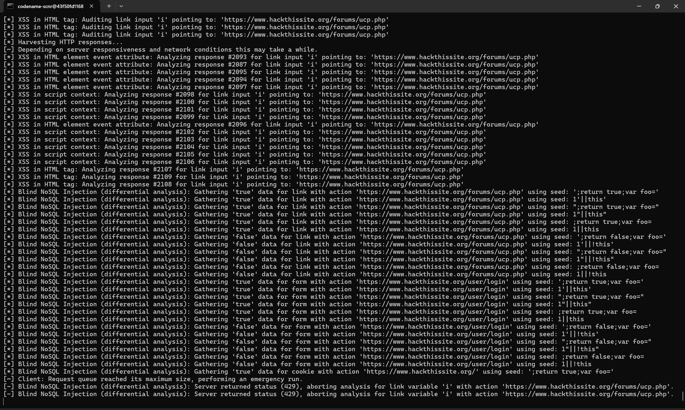
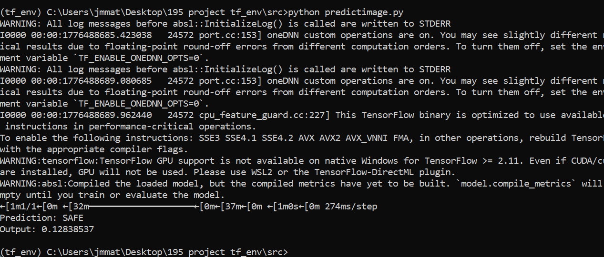
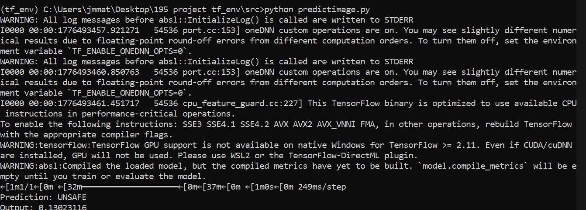
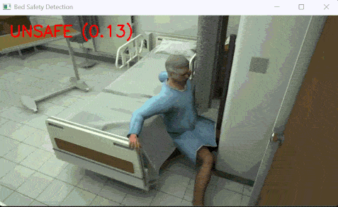

# FPGA-Vision Fall Alert System

## Team
- Devin Roberson (GitHub: @devin-roberson)
- Jan Michael Maturan (GitHub: @jm-mat)
- Joshua Lu (GitHub: @josh8ml)
- Miguel Rodriguez Martinez (GitHub: @MiguelM831)

## Project Description
An FPGA-based pose detection system that would send alerts when the subject is about to fall from their bed. Video Feed from a camera module will be enhanced with Super Resolution models to improve prediction accuracy.

## Proof of Concept Scope
The PoC demonstrates a barebones custom trained CNN that would identify an input image or video frame if a subject is in a safe or unsafe bed position. Hardware implementation, Super Resolution model inclusion and alert mechanisms are not part of this PoC scope.

## Prerequisites
Python 3.9-3.12
pip

## Installation
-Download and copy all python scripts, trained model file, and sample inputs into the same directory
-Install and/or verify python 3.9-3.12
-Install required python packages TensorFlow, PIL and OpenCV

## Running the PoC
Windows: 
- Open cmd 
- Change directory Script folder (cd ~\Script\) 
- run activate command
- change directory to src folder (cd ~\src\)
- run scripts (python train_cnn.py /python predictimage.py/ python predictvideo.py) 

## Demo
**Model training completed**

**Result of sample_input1 in predictimage.py**

**Result of sample_input2 in predictimage.py**

**Result of input_video in predictvideo.py**

## Technical Stack
Python 3.11
TensorFlow 2.12
TFMOT 0.7.3
Pillow (PIL)
OpenCV (cv2)
NumPy 

## What's Next (195B)
-Super Resolution model training and implementation 
-Camera module integration
-FPGA implementation
-Alert Mechanism(Mobile App) 
